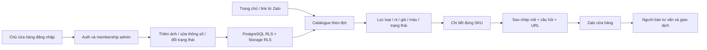

# Nghiên cứu nghiệp vụ và kiến trúc Ngân Giang

Ngày tổng hợp: 26/10/2026. Phạm vi đã được xác nhận: **catalogue xem thông tin, còn/hết hàng; toàn bộ tư vấn và giao dịch qua Zalo; chỉ chủ cửa hàng quản trị**.

## 1. Kiểm tra bảo toàn chức năng

1. Có bỏ, tắt, trì hoãn hoặc giảm chức năng đã thiết kế không? **Không.** Giữ toàn bộ trách nhiệm của bảng products, phân loại, thông số ngọc, ni, giá, ảnh, thư viện, video, mô tả, gom lô, công bố, thời gian và quyền quản trị. Không thiết kế checkout hoặc giữ hàng vì chủ cửa hàng đã xác nhận chúng không thuộc nghiệp vụ website.
2. Có xóa triển khai nào không? **Không có mã ứng dụng cũ để xóa.** UUID v4 dùng hàm PostgreSQL có sẵn `gen_random_uuid()` thay vì phụ thuộc extension `uuid-ossp`; cùng trách nhiệm tạo khóa UUID v4, được thực thi trong test tạo sản phẩm. Đây là schema dự án mới, không phải lệnh xóa hoặc dựng lại database hiện có.

## 2. Người dùng và công việc thực tế

| Người dùng | Công việc | Điều cần rõ trên giao diện |
|---|---|---|
| Người đến từ Zalo/Facebook | Tìm đúng mã, còn hay hết | Tìm SKU có dấu chấm; URL mở đúng món; trạng thái bằng chữ |
| Người mới mua ngọc | Chọn loại, ni, màu, khoảng tiền | Bộ lọc ít bước; hướng dẫn đo; đơn vị mm; giá VNĐ |
| Người đã có ni | Xem các món đúng ni | Ni vòng và nhẫn tách theo loại; ngưỡng tìm ±0,5 mm có nhãn |
| Người cân nhắc nhiều món | Xem lại sau, hỏi thêm | Lưu trên thiết bị; mã và liên kết dễ sao chép |
| Chủ cửa hàng | Lên đợt hàng từ điện thoại | Nhập thông số, tải nhiều ảnh, chọn ảnh đại diện, sửa còn/hết và ẩn nhanh |
| Người chưa được cấp quyền | Xem catalogue | Không cần đăng nhập; dù tự gọi API cũng không ghi dữ liệu |

Mỗi món độc bản là một SKU và một bản ghi. Nếu có nhiều món cùng tên nhưng khác ni, vân hoặc giá, tạo SKU riêng. Catalogue không có đồng bộ đơn từ Zalo: người bán phải cập nhật trạng thái khi giao dịch xong.

## 3. Những gì nghiên cứu cho thấy

### Vật liệu và kiểm định

Jade được dùng cho jadeite và nephrite. Không nên suy luận vật liệu chỉ từ tên bán “cẩm thạch/phỉ thúy”. Hệ thống thêm trường vật liệu riêng, mặc định “chưa công bố”. [GIA — Jade](https://www.gia.edu/jade)

GIA mô tả màu, độ trong và kết cấu là những yếu tố chính khi quan sát jadeite. Catalogue giữ tên thương mại “nếp mịn/nếp băng” nhưng không coi đó là chứng nhận. Vân, đặc điểm bề mặt và khuyết điểm cần mô tả từng món, kèm ảnh thật dưới các điều kiện sáng; không dùng một ảnh để khẳng định không xử lý. [GIA — Quality factors](https://www.gia.edu/jade-quality-factor)

A/B/C nói về xử lý trong cách phân loại được sử dụng tại thị trường Trung Quốc: A tự nhiên hoặc chỉ đánh bóng sáp; B tẩy và ngấm polymer; C nhuộm. Không phải thang điểm đẹp hay thang giá. Form và constraint yêu cầu đơn vị, mã phiếu và URL tài liệu khi ghi kết luận xử lý. Yêu cầu này bảo đảm có tài liệu tham chiếu, không tự xác thực độ thật của phiếu. [GIA — B jade](https://www.gia.edu/FAQ/gia-faq-b-jade)

### Ni vòng khác ni nhẫn

Ni được định nghĩa duy nhất là **đường kính trong tính bằng milimét**. Vòng bầu cần ghi hai trục và dáng trong phần kích thước/mô tả; không ép một số ni tròn thành cam kết đeo vừa. Người chưa có ni nên được tư vấn đo bàn tay hoặc thử vòng. Đường kính vòng cứng cần đi qua bàn tay; chu vi cổ tay không tự cho ra ni. [Mason-Kay — Bangle sizing](https://www.mkjadejewelry.com/pages/bangle-size-info)

Vì thế `ni_tay NOT NULL` cho tất cả loại trong đề xuất ban đầu là không đúng với mặt dây/ngọc khác. Bản sửa dùng `NULL` cho các loại không có ni, vẫn bắt buộc ni dương cho nhẫn/vòng. Cả UI và database kiểm tra điều kiện này. Bộ lọc ni chỉ hiện khi đã chọn loại nhẫn hoặc vòng.

### Chăm sóc

Hướng dẫn ngắn tập trung vào nước ấm, xà phòng dịu và khăn mềm; khi chưa biết xử lý, không khuyên tự dùng máy siêu âm hoặc hơi nước. Không đưa tuyên bố chữa bệnh, tài lộc hoặc bảo đảm phong thủy thành đặc tính sản phẩm. [GIA — Care and cleaning](https://www.gia.edu/jade-care-cleaning)

## 4. Luồng và cấu trúc thông tin



Thẻ sản phẩm ưu tiên ảnh → tên/mã → ni/chất → giá, có nhãn tình trạng bằng chữ. Chi tiết bổ sung kích thước, vật liệu, xử lý, kiểm định, thư viện và video nếu có. Hàng hết vẫn có thể công bố để tham khảo; CTA đổi sang hỏi mẫu tương tự. Hàng nhận đặt có CTA hỏi thời gian/điều kiện, không khiến khách tưởng sẵn hàng.

Liên kết từng món dùng `?san-pham=SKU`, không bị mất khi mở lại. Nội dung hỏi món phải được sao chép rồi dán vào Zalo; không dùng tham số tiền điền không được Zalo xác nhận hỗ trợ. Website không tự gửi tin nhắn.

## 5. Kiến trúc được chọn

```text
Static hosting (HTTPS)
  ├─ index.html / app.js: catalogue chỉ đọc
  ├─ admin.html / admin.js: form quản trị sau đăng nhập
  └─ repository.js: một lớp truy cập dữ liệu
         ├─ Supabase Auth: email/password của chủ cửa hàng
         ├─ PostgREST: public.products + RPC is_shop_admin
         └─ Storage: ảnh/video công khai của sản phẩm

PostgreSQL
  public.products       một nguồn dữ liệu sản phẩm
  private.shop_admins   membership do chủ database cấp
  private.product_audit lịch sử thay đổi, không lộ cho khách
```

Với catalogue quy mô cửa hàng nhỏ và không có checkout, static HTML/CSS/ES modules + Supabase đáp ứng nhu cầu mà không cần duy trì application server. Không chọn thêm Next.js/Redis/hàng đợi khi chưa có nhu cầu. Hosting và backend độc lập; có thể đưa `dist/` lên nền tảng static khác mà không đổi nguồn sản phẩm.

Khách không cần Supabase user. Publishable key chỉ xác định dự án, không cấp quyền admin. Khách đọc `is_published=true`; tài khoản thường cũng chỉ đọc. Tài khoản chủ cửa hàng phải có hàng tương ứng trong `private.shop_admins`. RPC chạy với `search_path` rỗng và quyền được giới hạn, kiểm tra `auth.uid()` tại database; không lấy quyền từ `user_metadata` do khách có thể sửa. [Supabase — RLS](https://supabase.com/docs/guides/database/postgres/row-level-security)

Mọi write vào sản phẩm và kho media đều dùng cùng kiểm tra admin. Khi xóa membership, các request sau bị chặn ngay, không đợi JWT cập nhật claim. Trang quản trị không có đăng ký đại trà, không có mật khẩu mặc định. Session chỉ giữ trong bộ nhớ tab, tự refresh token khi đang dùng; tải lại trang cần đăng nhập lại. [Supabase — Auth](https://supabase.com/docs/guides/auth/passwords), [Storage access control](https://supabase.com/docs/guides/storage/security/access-control)

## 6. Đánh giá SQL ban đầu

| Điểm ban đầu | Quyết định | Lý do |
|---|---|---|
| UUID + SKU unique | Giữ; dùng UUID v4 có sẵn, unique thêm theo `lower(sku)` | Khóa nội bộ ổn định; tránh `v052` và `V052` thành hai món |
| category enum | Giữ cả bốn loại | Đúng phạm vi đã đề xuất |
| stock/order/sold | Giữ | `sold` được trình bày “Đã hết hàng”; `order` chỉ dùng khi thật sự nhận đặt |
| `ni_tay NOT NULL` | Điều kiện theo loại | Mặt dây không có ni; nhẫn/vòng phải có đường kính trong |
| dimensions string | Giữ | Dễ mô tả bản, bầu, rộng/dày; đơn vị mm được ghi rõ |
| BIGINT giá | Giữ, kiểm tra dương và số nguyên an toàn cho JS | Không dùng float và không nhận giá âm |
| thumbnail/gallery/video | Giữ; HTTPS; Storage admin-only write | Ảnh thật do chủ cửa hàng tải, video click-to-play |
| description | Giữ | Đặc điểm vân, bề mặt, kiểm định và lưu ý |
| batch_date | Giữ; ngày mặc định theo Việt Nam | Đăng lô và gom section theo ngày, không phụ thuộc giờ UTC |
| timestamps | Giữ; trigger database cập nhật | Mặc định NOW() một mình không tự đổi updated_at khi sửa |
| is_published | Giữ | Ẩn sản phẩm mà không xóa lịch sử |
| indexes | Giữ trách nhiệm feed + category/supply/size; partial cho hàng công bố | Phù hợp query công khai, không lập GIN dư thừa |
| Public SELECT | Giữ với role explicit | Chỉ công bố được đọc |
| authenticated full access | Sửa thành membership admin tại DB | “Đăng nhập” không đồng nghĩa “chủ cửa hàng” |

Toàn bộ bản ghi trước/sau được audit, kể cả khi xóa. Trang quản trị dùng `id + updated_at` để sửa/xóa; nếu bản ghi đã thay đổi thì không ghi đè im lặng. Không tự xóa tệp khi gỡ ảnh hoặc xóa sản phẩm để tránh mất media đang được dùng ở nơi khác; người quản trị kho có thể rà tệp không còn tham chiếu riêng.

## 7. Tính mới, hiệu năng và giới hạn có chủ đích

- Khi mở chi tiết, lấy lại sản phẩm từ API để kiểm tra công bố và trạng thái. Catalogue cập nhật khi quay lại tab và mỗi 60 giây khi tab đang mở; báo rõ nếu chưa lấy được bản mới. Không cam kết tồn kho thời gian thực hoặc giữ hàng.
- REST tải từng trang 200 bản ghi, không bị dừng ở giới hạn 1.000 mặc định. Bộ lọc hiện chạy tại trình duyệt; với hàng nghìn món và nhu cầu lớn mới chuyển lọc/phân trang sang API bằng cùng các trường và index.
- Ảnh minh họa có WebP, lazy loading cho thẻ sản phẩm; font tại chỗ, không cần gọi Google Fonts khi khách mở web. Ảnh chủ cửa hàng tải hiện được giữ nguyên; nên dùng file ảnh đã tối ưu trước khi đăng. Có thể bổ sung dịch vụ biến thể ảnh theo nhu cầu nhưng không giả nhận đã có pipeline này.
- Liên kết chi tiết mở đúng món, nhưng metadata/ảnh chia sẻ hiện ở cấp thương hiệu. Nếu cần SEO/OG riêng từng SKU, cần prerender hoặc endpoint server tạo metadata từ cùng bảng; chưa được coi là đã triển khai.
- Bucket ảnh/video là công khai: URL ảnh đã biết vẫn có thể mở khi sản phẩm bị ẩn. Không dùng bucket này cho tài liệu nội bộ hay dữ liệu khách. Ẩn sản phẩm là ẩn catalogue, không phải xóa media khỏi Internet.
- Chưa có dịch vụ đơn hàng, thanh toán, giữ hàng, vận chuyển hoặc đồng bộ chat Zalo; đây là phạm vi chủ cửa hàng đã xác nhận, không phải các đường bị vô hiệu hóa để làm test qua.
